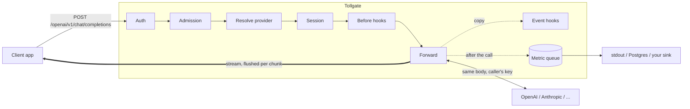

# Tollgate

**An LLM proxy you can embed.** Tollgate sits between your apps and LLM
providers (OpenAI, Anthropic, OpenRouter, or any compatible API). Every call
passes through it unchanged, and you get one place to authenticate callers,
limit them, track sessions and record usage. The response streams to the
client first; your code only watches a copy.

Use it as a **Go library** inside your own service, or run the
**`tollgated`** binary with a YAML file.

## What it does

- **Passes calls through unchanged.** Bodies, models and the caller's provider
  key (`Authorization` / `x-api-key`) go upstream as sent. Tollgate never
  stores or logs provider keys.
- **Streams first.** Server-sent events reach the client byte for byte, and
  each chunk is flushed at once. Hooks see a copy afterwards, so a slow or
  broken hook cannot stall the stream.
- **Knows the call.** It reads OpenAI chat and Anthropic messages into one
  neutral model: model, messages, tool calls, token usage and finish reason.
- **Records one metric per call**: tenant, session, provider, model, status,
  tokens, time to first byte and duration. Metrics go to stdout, Postgres or
  your own sink, through a bounded queue that never blocks a request.
- **Is extended through seams, not forks.** Auth, admission, routing, hooks,
  finalizers and metric sinks are small interfaces. A failing extension is
  skipped; the call goes through.

## How a call flows



The thick arrow is the client path, and nothing on it waits for an extension.
The dotted arrows run off that path.

## Run it

```sh
go -C cmd/tollgated run . serve
curl localhost:8080/openai/v1/chat/completions \
  -H "Authorization: Bearer $OPENAI_API_KEY" -H "Content-Type: application/json" \
  -d '{"model":"gpt-4o-mini","messages":[{"role":"user","content":"hi"}]}'
```

Your app talks to `http://localhost:8080/openai` instead of
`https://api.openai.com`. The other built-in providers are `/anthropic` and
`/openrouter`. Requires Go 1.26 or later.

### With a config file

```sh
TOLLGATE_KEY_TEAM_A=secret-a TOLLGATE_KEY_TEAM_B=secret-b \
  go -C cmd/tollgated run . serve -config ../../configs/tollgated.example.yaml
```

[`configs/tollgated.example.yaml`](configs/tollgated.example.yaml) is
commented and covers per-team keys, providers, per-tenant concurrency limits,
sessions, metrics and timeouts. Secrets come from `${ENV_VARS}`. Other
commands:

```sh
tollgated config check -config tollgated.yaml -json   # validate; lists every problem at once
tollgated version -json
```

On SIGTERM it stops accepting calls, lets in-flight streams finish (up to
`-shutdown-timeout`, 30s by default), then flushes metrics.

### Endpoints

| Listener | Path | What |
|---|---|---|
| proxy (`-listen`, `:8080`) | `/{provider}/...` | The proxied provider API |
| proxy | `GET /healthz`, `GET /readyz` | Liveness, and readiness (503 while the metric sink is failing) |
| admin (`-admin-listen`, off by default) | `GET /statusz`, `GET /metrics` | Queue and drop counters as JSON; Prometheus text |

Keep the admin listener private.

## Use it as a library

```go
import (
	"github.com/ethosagent/tollgate"
	"github.com/ethosagent/tollgate/ext/auth/statickeys"
	"github.com/ethosagent/tollgate/ext/metrics/stdout"
)

auth, err := statickeys.New(statickeys.Config{
	Keys: map[string]statickeys.Tenant{os.Getenv("TEAM_A_KEY"): {ID: "team-a"}},
})
if err != nil { return err }
p, err := tollgate.New(tollgate.Options{Auth: auth, Metrics: stdout.New(os.Stdout)})
if err != nil { return err }
p.Use(myHook{}) // a tollgate.Hook; embed tollgate.NoopHook and override what you need
if err := p.Start(ctx); err != nil { return err } // starts the metric batcher
defer p.Close(context.Background())                // flushes metrics

mux.Handle("/llm/", http.StripPrefix("/llm", p.Handler()))
```

The core uses only the standard library. Extensions that need a third-party
dependency are separate Go modules, so you download only what you import.

## Extension points

| Interface | Decides | Built in |
|---|---|---|
| `Authenticator` | Who is calling (401/403) | `ext/auth/statickeys` |
| `Admission` | Whether the call runs now (429, queue) | `ext/admission/concurrency` |
| `ProviderResolver` | Which upstream | Path prefix: `/openai`, `/anthropic`, `/openrouter` |
| `SessionStrategy` | Which conversation a call belongs to | Session header, or predicted from the messages |
| `Hook` | Change a request, watch events, act after the call | — |
| `Finalizer` | Hold the stream's last event: release it, replace it, or retry | — |
| `MetricSink` | Where metrics go | `ext/metrics/stdout`, `ext/metrics/postgres` (own module) |

Every extension call runs under `recover()` and a deadline.

## Test your extension

`testkit.Run` drives your plugin through a real proxy and a fake upstream
that replays recorded OpenAI and Anthropic responses. It needs no network and
no keys, and it returns every call your plugin received:

```go
rec := testkit.Run(t, myHook{}, "openai/chat-stream-text", "anthropic/messages")
before := rec.Of(testkit.StageBefore) // what Before saw, per call
```

`testkit.RunWith` adds several plugins, headers and upstream faults (latency,
a cut stream, an error status). For a worked example, see
[`ext/auth/statickeys/testkit_test.go`](ext/auth/statickeys/testkit_test.go).

## Performance

On one machine with 4 concurrent sessions, tollgate added about **0.17 ms** to
time to first byte (p50), and its p99 was within 0.3 ms of a plain relay.
Memory was about 45–72 KB per open stream. To re-measure:

```sh
go run ./cmd/tollgate-bench -sessions 200 -calls 4 -chunk-delay 20ms
```

Method, numbers and caveats: [`docs/performance.md`](docs/performance.md).

## Develop

```sh
scripts/install-hooks.sh   # once
scripts/run-checks.sh      # the gate CI runs: fmt vet mod arch lint test vuln docs size
```

| Read | For |
|---|---|
| [`ARCHITECTURE.md`](ARCHITECTURE.md) | The rules: layers, seams, limits, failure behaviour |
| [`docs/`](docs/README.md) | Orientation, conventions, decisions (ADRs), runbooks |
| [`CLAUDE.md`](CLAUDE.md) / `AGENTS.md` | The map for AI coding agents |
